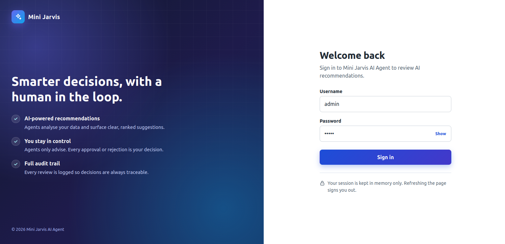
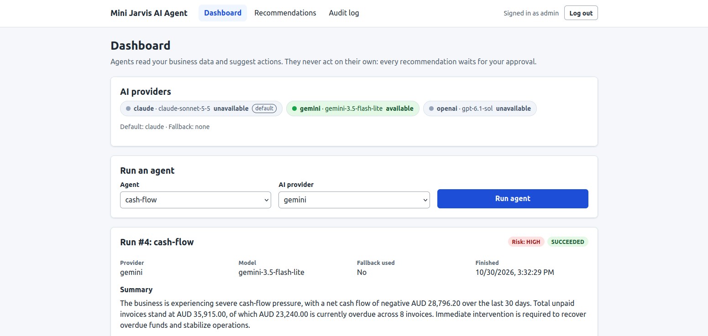
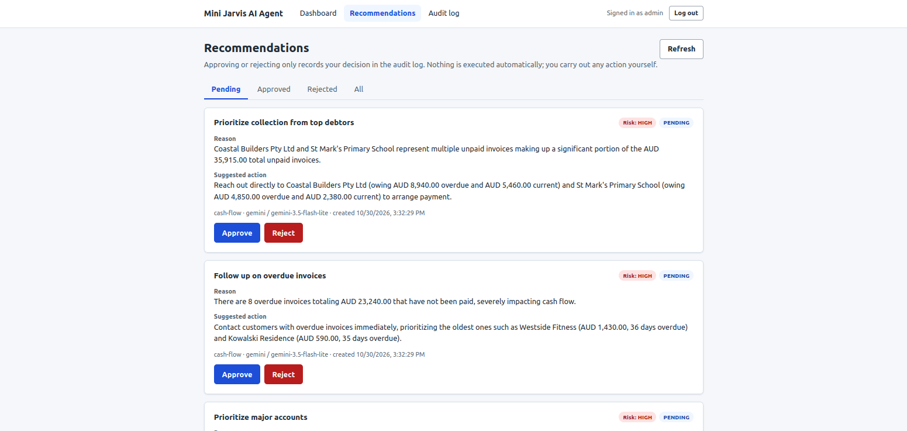
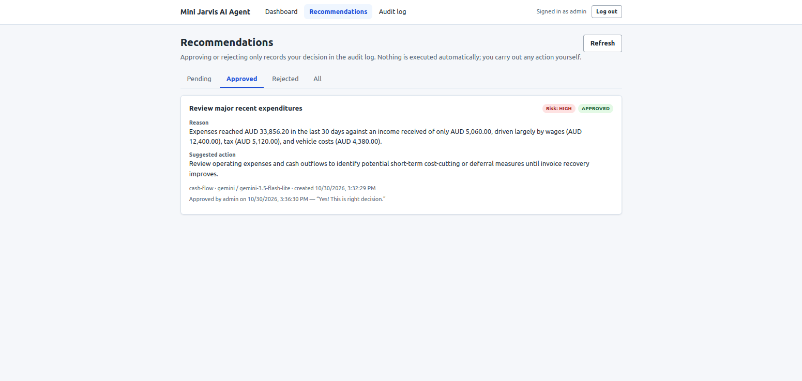
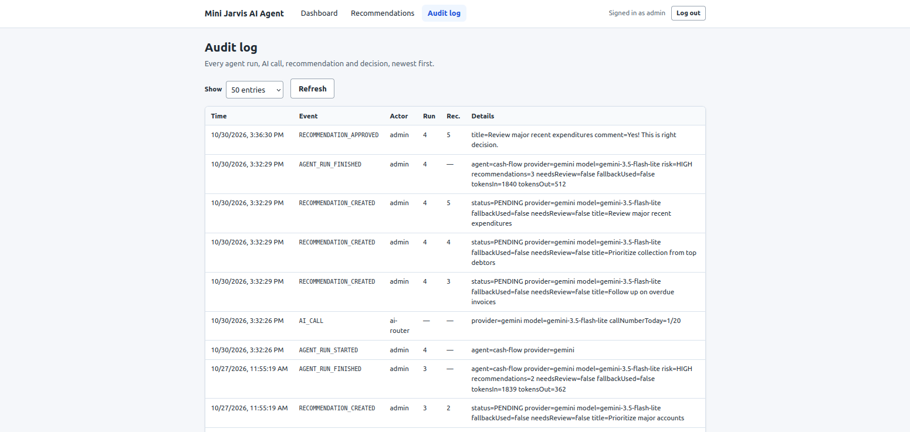

# mini-jarvis-ai-agent-ui

A React frontend for [mini-jarvis-ai-agent](https://github.com/softDevShishir/mini-jarvis-ai-agent), an **advisory-only**, human-in-the-loop AI agent service.

mini-jarvis-ai-agent agents read business data and ask an AI provider (Claude, Gemini or OpenAI) for recommendations. Every recommendation is created as `PENDING`. A human approves or rejects it, and every step is written to an audit log. This UI lets you:

- **Log in** with the backend's single admin account.
- **Dashboard**: see which AI providers are available, pick an agent and (optionally) a provider, run it, and read the result: status, provider, model, fallback, risk level, summary, review notes and the recommendations it created.
- **Recommendations**: filter by Pending / Approved / Rejected / All, and approve or reject pending items with an optional comment. **Approving only records the decision. It does not execute anything.**
- **Audit log**: the latest entries (10–500), with refresh.

Built with React 19, TypeScript, Vite 8 and react-router-dom, with plain CSS and a small `fetch`-based API client (`src/api/client.ts`). There are no state-management or HTTP libraries.

## Requirements

- Node.js **22.12+** or **24** (required by Vite 8)
- The mini-jarvis-ai-agent backend, running on `http://localhost:8080`

## Running locally

1. **Start the backend first** (in the sibling folder, see its README for the `.env` it needs):

   ```bash
   # clones the backend next to this folder; skip if it's already there
   git clone git@github.com:softDevShishir/mini-jarvis-ai-agent.git ../mini-jarvis-ai-agent
   cd ../mini-jarvis-ai-agent
   cp .env.example .env   # set JWT_SECRET, ADMIN_PASSWORD and at least one AI key
   docker compose up --build
   ```

2. **Start the frontend**:

   ```bash
   npm install
   npm run dev
   ```

   Open the URL Vite prints (usually http://localhost:5173) and log in with the backend's `ADMIN_USERNAME` / `ADMIN_PASSWORD`.

Other scripts:

| Command | What it does |
|---|---|
| `npm run build` | Type-check and build to `dist/` |
| `npm run preview` | Serve the production build locally |
| `npm run lint` | ESLint |
| `npm test` | Vitest + React Testing Library (no backend needed) |

### The dev proxy

In development the browser only talks to the Vite dev server. `vite.config.ts` forwards every request under `/api` to `http://localhost:8080`, so from the browser's point of view the API is on the same origin. The backend therefore needs **no CORS configuration** in development.

### Sign-in is kept in memory only

The access token lives only in React state. It is **never** written to `localStorage`, `sessionStorage` or cookies. As a result:

- **Refreshing the page or closing the tab logs you out**, and you need to log in again.
- **Log out** discards the token immediately.
- When the token expires (`JWT_TTL_MINUTES` on the backend, 60 by default), the next request returns 401. The UI then logs you out and sends you back to the login page with a notice.

This is deliberate: a token in memory cannot be read later by injected scripts or stay behind on a shared machine.

## Error handling

Every backend error has the same JSON shape (`timestamp, status, error, message, path, agentRunId?`), and the UI shows its `message` in an error banner. Some statuses get friendlier wording:

| Status | Shown as |
|---|---|
| 401 | Logged out and returned to login (on the login form: "Invalid username or password") |
| 409 | The recommendation was already approved or rejected |
| 429 | The daily AI call limit (`MAX_AGENT_RUNS_PER_DAY`) has been reached |
| 502 | The AI provider failed, including the failed run's id when the backend sends one |

## Deploying

Build with `npm run build` and serve `dist/` from any static host. Configure the host to fall back to `index.html` for unknown paths so that deep links like `/recommendations` work.

The dev proxy does not exist in production, so the browser has to reach the API in one of two ways:

1. **Same domain (recommended).** Serve the frontend and the API from one origin, for example with a reverse proxy that sends `/api/*` to the Spring Boot app and everything else to `dist/`. Leave `VITE_API_BASE_URL` empty. No CORS is needed.
2. **Separate domains.** Set `VITE_API_BASE_URL` at build time to the API origin (see `.env.example`), e.g. `VITE_API_BASE_URL=https://api.example.com npm run build`. The backend must then send CORS headers that allow **only the frontend's exact address** (for example `https://jarvis.example.com`) for the `Authorization` and `Content-Type` headers on `GET`/`POST`. Never use a wildcard origin. mini-jarvis-ai-agent supports this through the `CORS_ALLOWED_ORIGINS` setting (comma-separated exact origins; empty means CORS is off); see its [README](https://github.com/softDevShishir/mini-jarvis-ai-agent#readme).

`VITE_*` variables are compiled into the public JavaScript bundle. Never put secrets in them.

## Screenshots

The screenshots use the demo data of a fictional business.

### Login

The sign-in page, with the product overview beside the form.



### Dashboard

AI provider status, the agent run form and the result of a cash-flow agent run.



### Recommendations

Pending recommendations, each with its reason, suggested action and Approve / Reject buttons.



### Approved recommendation

An approved recommendation, showing who approved it, when, and their comment.



### Audit log

Every agent run, AI call, recommendation and decision, newest first.



## Project layout

```
src/
  api/types.ts          TypeScript mirrors of the backend DTOs (web/Dtos.java, ApiError, TokenResponse)
  api/client.ts         fetch wrapper: bearer token, error parsing, 401 hook, friendly messages
  auth/                 in-memory auth context, provider and route guard
  components/           layout, recommendation card, modal, badges, error banner
  pages/                Login, Dashboard, Recommendations, Audit log
```
